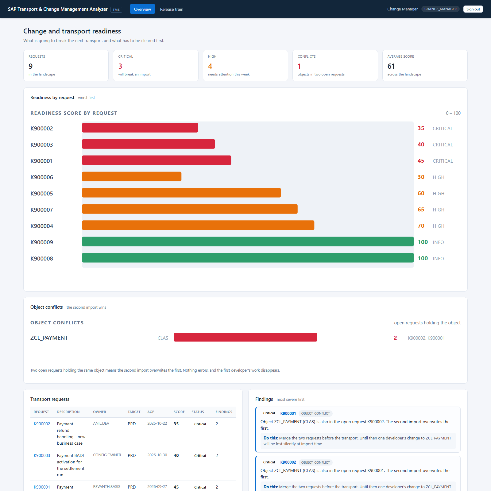
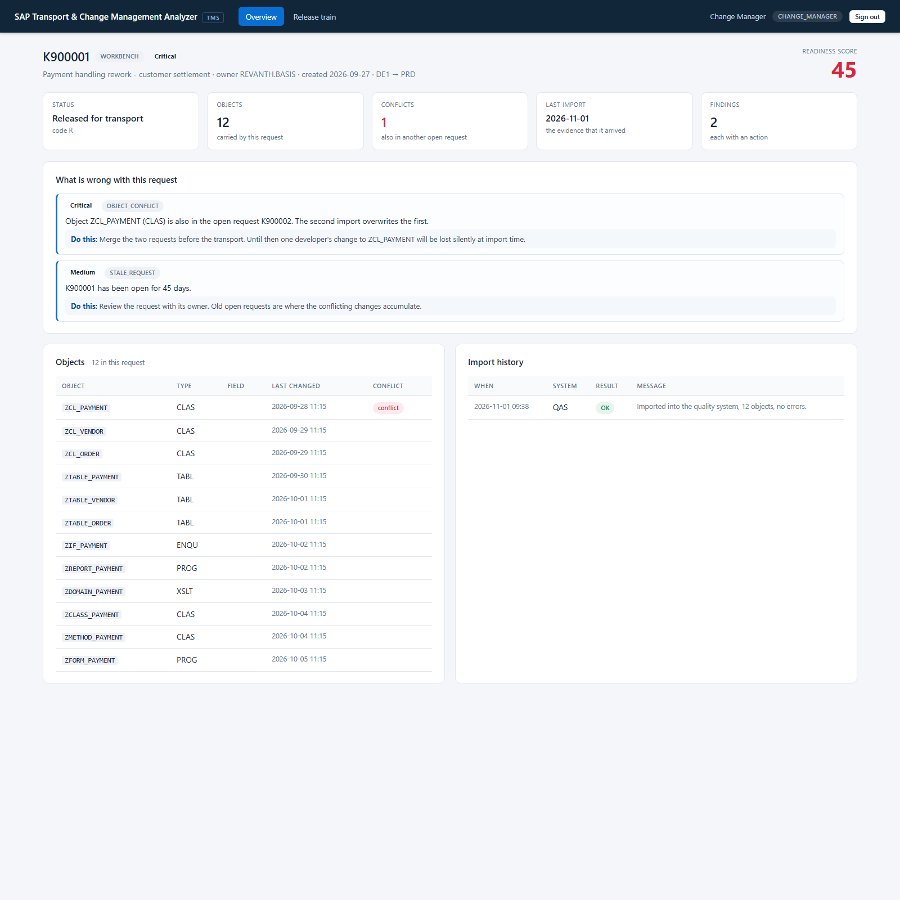
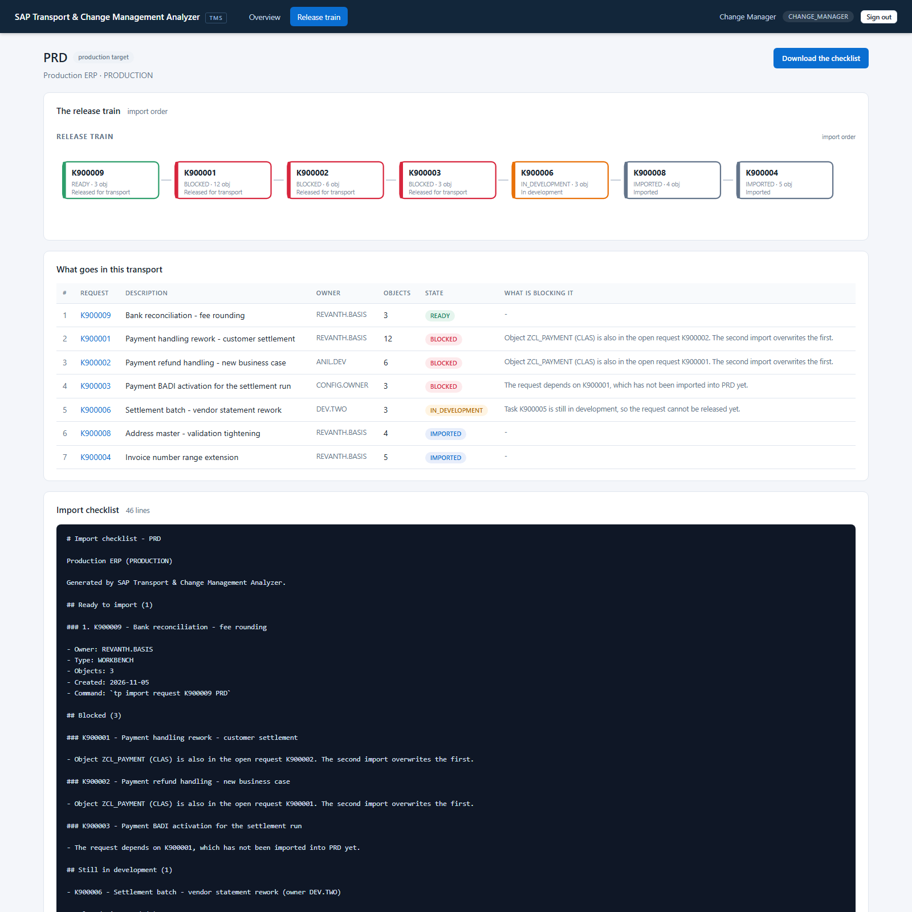
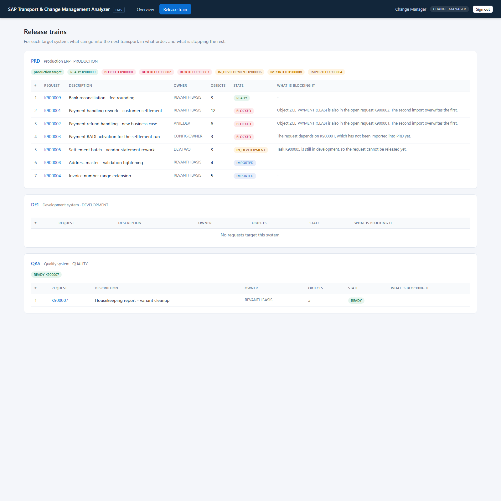
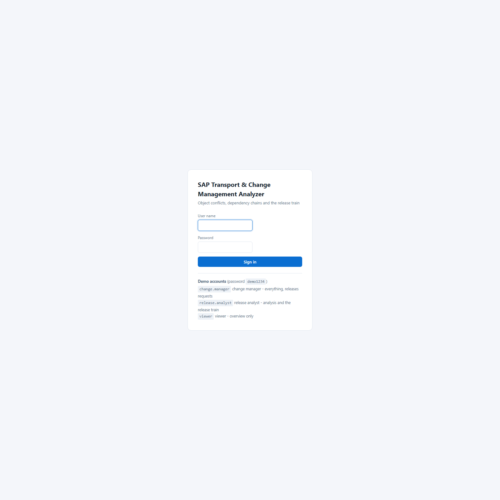

<div align="center">

# SAP Transport &amp; Change Management Analyzer

**Change and transport management for SAP landscapes — object conflict detection, dependency chains, stale requests and a release train per target system**


</div>

---

## The problem

*"Which transport requests can go into the next release?"*

SE09 answers "which requests are open". It does not answer the question a
release manager actually has, which is **"what can go, in what order, and what
is stopping the rest"** — and it certainly does not answer the question that
blows up a transport window:

> Two developers changed the same class in two different requests. The first
> import wins, the second import overwrites it, and the first developer's work
> disappears **without an error, without a warning, and without anyone
> noticing until the bug report arrives.**

That is the conflict. It is the single most common way a transport goes wrong,
and it is invisible in every list of open requests, because both requests look
perfectly reasonable on their own.

This analyzer turns the transport system into an argument:

1. **Does it conflict?** — one object in two open requests, listed by object,
   not by request.
2. **Can it go?** — the dependency chain, resolved against the *target*
   system, not against "was it imported somewhere".
3. **Did it go?** — the import history, which is the only evidence that a
   request ever reached production.
4. **Did it stay put?** — an object changed in development *after* the last
   transport. The hotfix that was never taken.
5. **Has anybody come back to it?** — the request that has been open for three
   months and is not going anywhere.

The result is a per-request readiness score **and the release train** — the
ordered list of what can go into the next transport, with the command to run
it and the reason the rest cannot.

---

## Screenshots

### The overview — what is going to break the next transport

> K900001 and K900002 both hold `ZCL_PAYMENT`. The second import wins, and
> the first developer's work disappears. The tool says so, names both
> requests, and tells you what to do about it.



### One request — the objects, the conflict and the import evidence



### The release train — what goes in this transport, and what does not

> Exactly one request can go. Three are blocked, one is unfinished and two
> are already in production. The checklist names the command.



### All release trains



### Sign in



---

## Run it

### Requirements

* **Java 8 or newer** (the code targets Java 8 and `javax.servlet`, so it can
  be deployed on the NetWeaver 7.5 Java stack)
* **Maven 3.6+**
* Nothing else. No SAP system, no SAP licence, no database server.

```bash
git clone https://github.com/Revanth2716/sap-transport-analyzer.git
cd sap-transport-analyzer
mvn clean package
java -jar target/sap-transport-analyzer.jar
```

Open <http://localhost:8085> and sign in:

| User | Role | Sees |
|---|---|---|
| `change.manager` | CHANGE_MANAGER | Everything, including releasing a request and exporting the checklist |
| `release.analyst` | ANALYST | The analysis and the release train |
| `viewer` | VIEWER | The overview only |

Password: `demo1234` (configurable; switch the accounts off with
`transport.seed-demo-users=false`).

### Run the tests

```bash
mvn test
```

```
Tests run: 65, Failures: 0, Errors: 0, Skipped: 0
BUILD SUCCESS
```

---

## The landscape it ships with

The seeded data is not random noise — every request exists because it
demonstrates one specific finding:

| Request | Score | Status | The story |
|---|---|---|---|
| **K900002** | 35 | CRITICAL | Released, never imported, and it holds `ZCL_PAYMENT` — **the other half of the conflict** |
| **K900003** | 40 | CRITICAL | A customizing request blocked because K900001 reached QA but **not PRD** |
| **K900001** | 45 | CRITICAL | The big workbench request, open for 45 days, **sharing an object with K900002** |
| **K900006** | 30 | HIGH | A workbench request whose task is **still in development**, so it cannot be released |
| **K900005** | 60 | HIGH | A task that has been in development for **70 days** |
| **K900007** | 65 | HIGH | Released, but still pointing at QA — **it never made it to production** |
| **K900004** | 70 | HIGH | Imported 60 days ago, and an object was **changed ten days ago** |
| **K900009** | 100 | INFO | Clean and ready — **the only request that can go into the next transport** |
| **K900008** | 100 | INFO | Imported cleanly and untouched since. The control |

**The release train for PRD is the point of the whole project:** one request
can go, three are blocked, one is unfinished, two are already in production —
and each blocked request says exactly why.

---

## Architecture

```
                    ┌────────────────────────────────────────┐
                    │        web layer (Spring MVC)          │
                    │  Overview · Request detail · Release   │
                    │  train · Import checklist · REST API   │
                    └───────────────────┬────────────────────┘
                                        │
                    ┌───────────────────▼────────────────────┐
                    │            service layer               │
                    │  TransportAnalysisService              │
                    │    · object conflicts                   │
                    │    · dependency chains                  │
                    │    · import evidence                    │
                    │    · severity = the worst finding       │
                    │  ReleaseService · release train, order  │
                    │  AuditService                          │
                    └───────────────────┬────────────────────┘
                                        │
                    ┌───────────────────▼────────────────────┐
                    │       repository layer (JdbcTemplate)   │
                    │  TMS_REQUEST · TMS_OBJECT ·             │
                    │  TMS_DEPENDENCY · TMS_IMPORT ·           │
                    │  TMS_SYSTEM                              │
                    └───────────────────┬────────────────────┘
                                        │
              ┌─────────────────────────┴─────────────────────────┐
              │                                                   │
   ┌──────────▼───────────┐                        ┌──────────────▼─────────────┐
   │  H2 (local, seeded)  │                        │  SAP HANA                  │
   │  the demo database   │                        │  live NetWeaver landscape  │
   └──────────────────────┘                        └────────────────────────────┘
```

Five decisions carry the project:

**1. Conflicts are found by object, not by request.**
The unit of the analysis is the **object key** — name plus type for a
workbench object, name plus field for a customizing entry. Two requests
holding the same key collide; a class and a table that happen to share a name
do not. Reporting the conflict per object rather than per request is what
makes it actionable, because the fix is to merge those two requests.

**2. Only *open* requests conflict.**
A request that has already been imported is not a conflict — its objects are
in the target system, and a new request changing the same object is a normal
succession, not a collision.

**3. A dependency is satisfied by the target system, not by "somewhere".**
K900001 reached QA but not PRD. A customizing request going to PRD is still
blocked, because PRD is where it has to land. This one rule is what makes the
release train correct rather than merely plausible.

**4. "Blocked" and "unfinished" are different states.**
A request still in development is not blocked — it is simply not ready. A
request that is released and *cannot go* is blocked. Collapsing the two would
produce a release train where nothing is ever importable.

**5. The severity is the worst finding, not the score band.**
A failed import costs 35 points and scores 65 — "medium" on a score band, and
**critical** in reality. If the severity came from the score, the conflict
that breaks the transport would be filed next to a stale request.

---

## The SAP-side artifacts

The ABAP and the RFC client that a live NetWeaver system would talk to are
included. They are written against NetWeaver 7.5 semantics and are **ready to
compile**; they have not been executed on a live system, because none was
available when this was built (see [`docs/HONEST-STATUS.md`](docs/HONEST-STATUS.md)).

| File | Purpose |
|---|---|
| `abap/Z_TRANSPORT_LIST.abap` | RFC-enabled function module reading the request headers from `E070` and the object lists from `TRDIR` |
| `abap/Z_TR_TYPES.abap` | The DDIC structures (`ZTR_REQ`, `ZTR_OBJ`) the module imports and exports |
| `src/extra/java/.../RfcTransportGateway.java` | JCo client that calls it over an RFC destination maintained in `SM59` |
| `src/main/java/.../TransportGateway.java` | The interface that keeps RFC out of the rest of the code |

> **The one line that decides whether RFC works at all:** create the function
> module in `SE37` with **Remote-Enabled** ticked. Without it the call fails
> with *"function module not found / not remote enabled"* — and the error
> surfaces as an `SM58` entry on the **calling** system, not as a dump on the
> callee. That asymmetry is what makes it confusing the first time.

> **What the function module deliberately does not do:** decide whether a
> request may be imported. The database knows what was transported; only the
> analyzer knows what conflicts with what.

---

## Moving to a live SAP system

```bash
mvn -Pwith-jco clean package     # adds the JCo RFC adapter
mvn -Phana   clean package       # adds the SAP HANA JDBC driver
```

Then set `transport.gateway: jco` and copy `jco.properties.example` to
`jco.properties`. The SQL is portable ANSI, so pointing the datasource at
HANA is a configuration change, not a code change. Full detail in
[`docs/DEPLOYMENT.md`](docs/DEPLOYMENT.md).

---

## Testing

65 tests across five classes:

| Test class | What it locks in |
|---|---|
| `TransportAnalysisServiceTest` | Each rule on its own — a conflict, a blocked dependency, a dependency that reached the **wrong system**, an open task, a failed import, an object changed after the import, a stale request, a request pointing at the wrong system — and that **the severity is the worst finding, not the score band** |
| `TransportLandscapeTest` | The story the seeded landscape has to tell, request by request, plus the release train and the checklist |
| `StartupGateTest` | The application is closed until the seeders have run |
| `ApiControllerTest` | The REST API, that it is authenticated, that the health check is open, and that it never leaks a stack trace |
| `PageRenderTest` | **Every screen renders** — a template can compile and the service layer can be green while one page still returns HTTP 500 |

Two real bugs were caught by these tests while the project was being built:

* **a request in development was reported as "blocked"** on the release train.
  Blocked means *released and held back*; a request that is not released yet
  is simply unfinished. The two states are now separate.
* **a failed import produced two findings** — "the import failed" *and* "there
  is no evidence of an import". The second one now only fires when there is no
  import attempt at all, so one problem produces one finding.

---

## Resume content

Copy-paste blocks are in [`docs/RESUME.md`](docs/RESUME.md). The short form:

> **SAP Transport & Change Management Analyzer** — change and transport management for SAP landscapes
> *Java 8 · Spring Boot 2.7 · JdbcTemplate · SAP HANA · ABAP RFC · SAP Java Connector*
>
> - Built a **change and transport management analyzer** for SAP landscapes that detects **object conflicts** across open transport requests — the case where two requests carry the same object and the second import silently overwrites the first — resolves **dependency chains** against the target system, and verifies **import evidence** and objects changed after the last transport.
> - Designed a **release train** per target system that separates *ready*, *blocked* and *unfinished* requests, orders the importable ones by dependency, and generates an **import checklist with the `tp` commands** — so a release window is planned from evidence rather than from memory.
> - Shipped the SAP-side artifacts (**RFC-enabled ABAP function module** reading `E070` and `TRDIR`, **SAP Java Connector client** behind an optional Maven profile) on **portable ANSI SQL** that runs unchanged on local H2 and SAP HANA, with **65 automated tests**.

---

## Honest status

| | |
|---|---|
| **Works and is tested today** | the whole application: 65 tests green, the JAR builds, every screen is rendered from the running app |
| **Written but not compiled against SAP** | the ABAP function module, the DDIC types, the JCo adapter — no NetWeaver system and no access to SAP's Maven repository |
| **Modelled, not measured** | the transport requests, the object lists and the import history are a seeded synthetic dataset, not a customer's landscape |
| **Known limitation** | the exact field names of `E070` and `TRDIR` differ between releases and between the classic and the new status model, and the per-object change timestamp is not held in the transport tables at all — it comes from the change log |

Full detail, and the step that closes each gap, in
[`docs/HONEST-STATUS.md`](docs/HONEST-STATUS.md).

---

## Documentation

| Document | Read it when |
|---|---|
| [`ARCHITECTURE.md`](docs/ARCHITECTURE.md) | You want to know why it is built this way |
| [`DEPLOYMENT.md`](docs/DEPLOYMENT.md) | You are moving it to a real SAP landscape |
| [`TROUBLESHOOTING.md`](docs/TROUBLESHOOTING.md) | A finding looks wrong, or an RFC call fails |
| [`RESUME.md`](docs/RESUME.md) | You are putting this on a CV |
| [`INTERVIEW-QA.md`](docs/INTERVIEW-QA.md) | You are preparing to be asked about it |
| [`HONEST-STATUS.md`](docs/HONEST-STATUS.md) | You need to know exactly what to claim |
| [`LEARNING-LOG.md`](docs/LEARNING-LOG.md) | You want to see the thinking behind the code |

---

## Roadmap

- [ ] Compile and run the ABAP and JCo artifacts against NetWeaver 7.5
- [ ] Read the per-object change timestamp from the change log (`CDHDR` /
      `CDCLS`) instead of the request date
- [ ] Detect the **overlapping-import** case: two requests touching the same
      object where one was created after the other was imported
- [ ] Add the transport log itself, so a failed import shows the actual
      `tp` error rather than a summary
- [ ] Model the **transport route** (DE1 → QAS → PRD) as a graph, so the
      checklist can show the whole path a change has to travel
- [ ] Compare a request against what is already in the target system, to
      catch the object that was deleted in development and is still live

---

## License

MIT — see [LICENSE](LICENSE).

This is a self-initiated portfolio project. SAP, NetWeaver, ABAP, SAP HANA and
the table and transaction codes referenced here are trademarks of SAP SE and
are used for technical reference and educational purposes.
